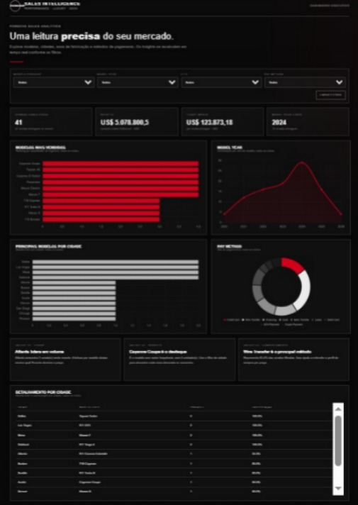
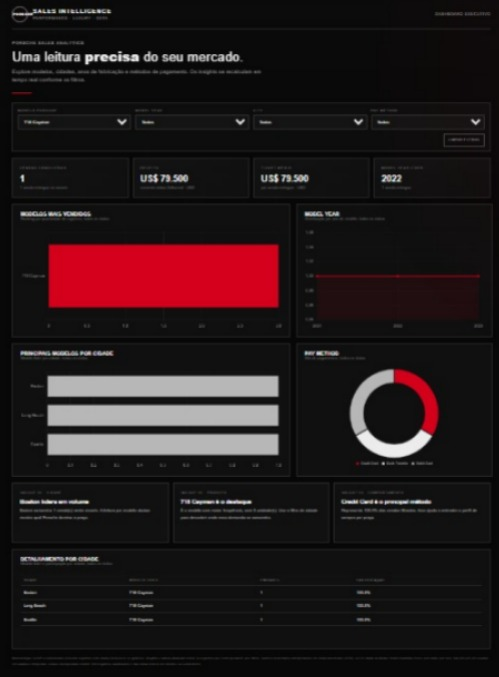

# Porsche Sales Intelligence Dashboard

Dashboard interativa para explorar uma base sanitizada de vendas Porsche, com foco em indicadores de vendas concluídas, distribuição por modelo e ano-modelo, comparação entre cidades e formas de pagamento.

> **Projeto de portfólio / desafio DIO.** Os valores monetários são interpretados como dólares americanos (USD), conforme a convenção confirmada para este projeto.

## Visão geral

A dashboard foi construída em um único arquivo HTML, com estrutura em HTML, estilos CSS e lógica em JavaScript. Os gráficos são renderizados com Chart.js.

### Recursos

- Filtros por modelo Porsche, ano-modelo, cidade e forma de pagamento.
- Indicadores de vendas concluídas, receita, ticket médio e ano-modelo líder.
- Gráficos de distribuição por modelo e ano-modelo.
- Comparação dos principais modelos por cidade.
- Distribuição por forma de pagamento.
- Tabela de detalhamento por cidade.
- Insights gerados a partir dos dados exibidos.
- Layout responsivo com identidade visual escura e acentos em vermelho, inspirado no universo visual da Porsche.

## Perguntas de negócio

A dashboard foi organizada para ajudar a responder às seguintes perguntas:

1. **Quais modelos aparecem com maior frequência na base?**  
   O ranking de modelos ajuda a identificar quais veículos concentram mais registros.

2. **Qual ano-modelo aparece com maior frequência?**  
   A distribuição por ano-modelo permite comparar a composição da base por geração/ano do veículo.

3. **Quais modelos se destacam em cada cidade?**  
   A visualização por cidade permite comparar o modelo mais frequente em cada localidade.

4. **Como os registros se distribuem por forma de pagamento?**  
   O gráfico de formas de pagamento mostra a frequência de cada modalidade registrada.

Os filtros permitem explorar essas perguntas por diferentes recortes.

**Ano-modelo** é o ano do veículo, não o ano em que a venda aconteceu.

## Indicadores e metodologia

### KPIs principais

Os KPIs de vendas concluídas consideram somente registros cujo status é `Delivered`:

- **Vendas concluídas:** quantidade de registros com status `Delivered`.
- **Receita:** soma dos valores dos registros `Delivered`, em USD.
- **Ticket médio:** receita dos registros `Delivered` dividida pela quantidade desses registros.
- **Ano-modelo líder:** ano-modelo mais frequente entre os registros usados para o KPI.

Na base analisada, há **41 registros `Delivered`**, com receita total de **US$ 5.078.800,50** e ticket médio de **US$ 123.873,18**. Esses números podem mudar quando os filtros são aplicados.

### Gráficos e detalhamentos

Os gráficos, insights e a tabela exploram todos os registros que correspondem aos filtros selecionados, inclusive registros que ainda não foram entregues ou que foram cancelados.

Portanto, esses gráficos descrevem a composição dos registros filtrados e não devem ser interpretados automaticamente como vendas concluídas.

Essa distinção foi mantida intencionalmente: os KPIs principais medem vendas entregues, enquanto as visualizações complementares ajudam a entender o conjunto de registros e seus status.

### Tratamento de dados

- A dashboard utiliza os campos sanitizados relevantes para as análises.
- Os 100 registros estão incorporados ao HTML para permitir a visualização sem um servidor de dados separado.
- **24 datas inválidas** foram mantidas como valores sem data (`null`), sem tentar adivinhar ou corrigir datas ausentes.
- Como há datas inválidas, a base não deve ser usada para conclusões temporais completas sem uma etapa adicional de validação.
- Nomes de clientes e vendedores não foram incluídos no conjunto de dados incorporado.
- Os valores de preço são exibidos em dólar americano (USD), conforme a convenção definida para o projeto.

## Tecnologias utilizadas

- HTML
- CSS
- JavaScript
- [Chart.js](https://www.chartjs.org/)
- Git e GitHub
- GitHub Pages para publicação

A biblioteca Chart.js é carregada por CDN. Por isso, é necessária uma conexão com a internet para que os gráficos sejam renderizados.

## Como executar localmente

1. Baixe ou clone este repositório.
2. Abra `index.html` em um navegador moderno.
3. Mantenha a conexão com a internet para carregar o Chart.js.
4. Use os filtros para explorar os dados e observe como os indicadores e gráficos respondem à seleção.

Não é necessário instalar dependências locais para abrir a versão publicada como HTML estático.

## Publicação no GitHub Pages

1. O arquivo `index.html` e este `README.md` ficam na raiz do repositório.
2. O GitHub Pages está configurado para publicar a branch `main`, na pasta `/(root)`.
3. Acesse a URL publicada abaixo e teste os filtros e gráficos em um navegador.
4. Para futuras atualizações, envie as alterações para a branch `main`; o GitHub Pages publicará a nova versão após a implantação.

**Endereços do projeto publicado:**

- **Repositório:** https://github.com/Maycon-Pereira84/dashboard_porshe_sales
- **Dashboard publicada:** https://maycon-pereira84.github.io/dashboard_porshe_sales/

## Processo de desenvolvimento e uso de IA

O ChatGPT foi utilizado como apoio para revisar a estrutura da dashboard, discutir as perguntas de negócio, conferir a metodologia dos indicadores, refinar a documentação e orientar a publicação.

A decisão analítica mais importante foi separar os KPIs de vendas concluídas das análises complementares que consideram todos os registros filtrados.

Também foi documentado o tratamento conservador das datas inválidas, sem preencher informações por suposição.

### Exemplo de prompt utilizado

> Analise a base sanitizada de vendas Porsche e ajude a construir uma dashboard interativa em um único arquivo HTML. Inclua filtros por modelo, ano-modelo, cidade e forma de pagamento; KPIs de vendas concluídas, receita e ticket médio; gráficos que respondam a perguntas de negócio; e uma identidade visual escura com acentos em vermelho. Considere apenas registros com status `Delivered` nos KPIs principais, mantenha os demais registros disponíveis para as análises complementares, interprete os valores monetários em USD e preserve datas inválidas como sem data. Explique as decisões de tratamento e documente as limitações.

## Fonte dos dados

Base de dados sanitizada disponibilizada no desafio DIO **"Criando Agentes de Tratamento de Dados"**:

[Planilha base Porsche (sanitizada)](https://hermes.dio.me/files/assets/8683bed0-cc33-4e06-bca9-04db9c31f9e2.xlsx)

## Limitações conhecidas

- As 24 datas inválidas não permitem uma análise temporal completa e confiável sem validação da origem.
- A dashboard é uma página estática; os dados estão incorporados no HTML e não são atualizados automaticamente.
- A biblioteca Chart.js depende de conexão com a internet.
- Os gráficos complementares incluem registros de diferentes status; para avaliar somente vendas concluídas, consulte os KPIs principais ou filtre/interprete os dados de acordo com a metodologia descrita.

## Próximos passos

- Validar as datas inválidas com a fonte original, se houver informação confiável disponível.
- Adicionar uma análise temporal depois da validação das datas.
- Evoluir as análises por cidade e status, preservando a distinção entre registros e vendas concluídas.

## Capturas de tela

### Dashboard completa

### Dashboard com filtro aplicado

---

Desenvolvido como projeto de aprendizado e análise de dados.